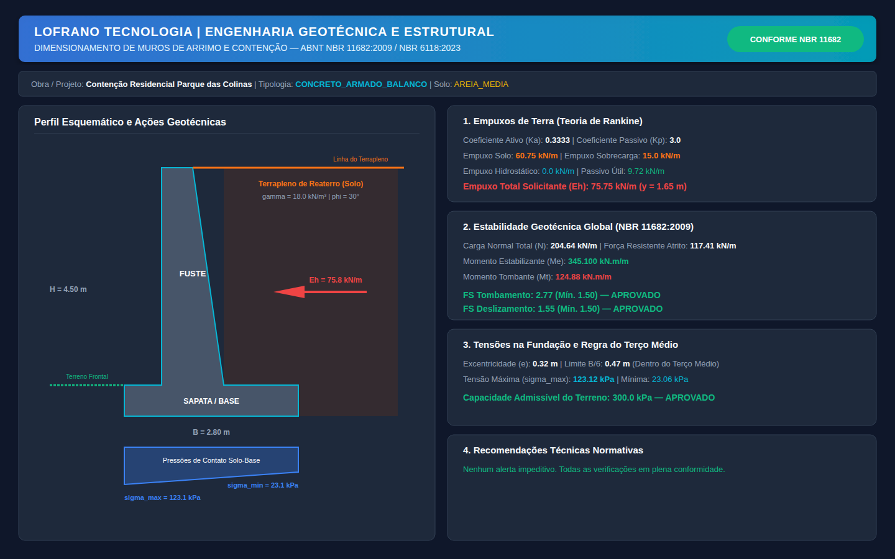
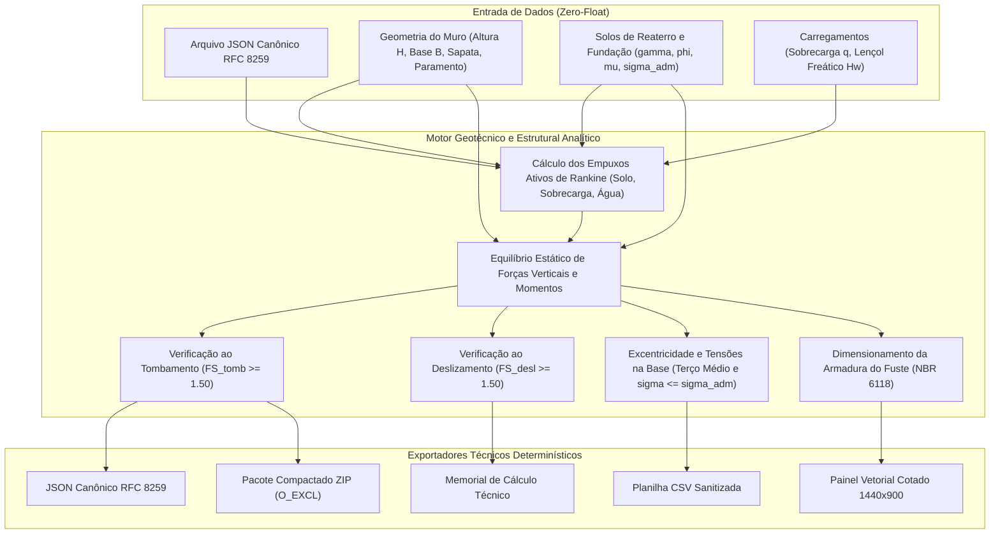

# Dimensionamento de Muros de Arrimo e Contenção (ABNT NBR 11682:2009)

[](https://github.com/martinlofranodeoliveira/dimensionamento-muros-arrimo-nbr11682/actions/workflows/ci.yml)
[](https://www.python.org/)
[](LICENSE)
[-emerald.svg)](https://docs.python.org/3/library/fractions.html)
[](https://www.abnt.org.br/)

Motor computacional determinístico e analítico para dimensionamento geotécnico e estrutural de obras de contenção e muros de arrimo (concreto armado em balanço, gravidade em concreto ciclópico, alvenaria de pedra e gabião) conforme as normas técnicas **ABNT NBR 11682:2009** (*Estabilidade de Encostas*) e **ABNT NBR 6118:2023** (*Projeto de Estruturas de Concreto*).

Desenvolvido no padrão de engenharia **LOFRANO TECNOLOGIA**, com **Zero Dependências externas** (exclusivamente biblioteca padrão do Python), **Zero-Float** (aritmética 100% exata com números inteiros e frações racionais `fractions.Fraction`) e conformidade estrita com RFC 8259.

---

## Painel Esquemático de Engenharia

O módulo gera automaticamente diagramas vetoriais SVG em resolução 1440x900 apresentando o corte esquemático cotado da contenção, terrapleno, prismas de empuxo ativo, diagrama trapezoidal/triangular de tensões na base de fundação e quadro comparativo dos fatores de segurança:



---

## Fundamentação Teórica e Normativa

### 1. Empuxo de Terra Ativo (Teoria Clássica de Rankine)

Para um maciço de solo homogêneo com superfície horizontal e paramento vertical liso, o coeficiente de empuxo ativo de terra ($K_a$) e o coeficiente passivo ($K_p$) são definidos pelo círculo de Mohr e envoltória de ruptura de Mohr-Coulomb:

$$K_a = \frac{1 - \sin\phi}{1 + \sin\phi} = \tan^2\left(45^\circ - \frac{\phi}{2}\right)$$

$$K_p = \frac{1 + \sin\phi}{1 - \sin\phi} = \tan^2\left(45^\circ + \frac{\phi}{2}\right)$$

Onde:
- $\phi$: ângulo de atrito interno do solo de reaterro.

#### Componentes dos Empuxos Horizontais Solicitantes:
1. **Empuxo Ativo do Solo**:
   $$E_{a,\text{solo}} = \frac{1}{2} \cdot \gamma \cdot H^2 \cdot K_a \quad \left[\text{aplicado a } y_1 = \frac{H}{3} \text{ acima da base}\right]$$

2. **Empuxo Ativo de Sobrecarga Uniforme no Terrapleno ($q$)**:
   $$E_{a,q} = q \cdot K_a \cdot H \quad \left[\text{aplicado a } y_2 = \frac{H}{2} \text{ acima da base}\right]$$

3. **Empuxo Hidrostático de Lençol Freático ($H_w$)**:
   $$E_w = \frac{1}{2} \cdot \gamma_w \cdot H_w^2 \quad \left[\text{aplicado a } y_w = \frac{H_w}{3} \text{ acima da base}\right]$$

4. **Empuxo Total Solicitante e Momento Tombante**:
   $$E_{\text{total},h} = E_{a,\text{solo}} + E_{a,q} + E_w$$
   $$M_{\text{tomb}} = E_{a,\text{solo}} \cdot \frac{H}{3} + E_{a,q} \cdot \frac{H}{2} + E_w \cdot \frac{H_w}{3}$$

---

### 2. Estabilidade Geotécnica Global (ABNT NBR 11682:2009)

As verificações de segurança são conduzidas em relação ao pé frontal da fundação (ponto O):

#### A. Segurança contra Tombamento
A relação entre o somatório dos momentos estabilizantes gerados pelos pesos próprios da estrutura, prisma de solo sobre o talão posterior e sobrecargas verticais ($M_{\text{estab}}$) e o momento tombante dos empuxos ($M_{\text{tomb}}$) deve satisfazer o fator de segurança mínimo:

$$F_{S,\text{tomb}} = \frac{\sum M_{\text{estab}}}{\sum M_{\text{tomb}}} \ge 1{,}50$$

#### B. Segurança contra Deslizamento na Base
A resistência ao deslizamento é proporcionada pelo atrito na interface concreto-solo ($\mu = \tan\delta_{\text{base}}$) e, quando existente, pela contribuição minorada do empuxo passivo frontal ($E_p$):

$$R_{\text{desl}} = N \cdot \mu + \frac{E_p}{2}$$

$$F_{S,\text{desl}} = \frac{R_{\text{desl}}}{E_{\text{total},h}} \ge 1{,}50$$

#### C. Excentricidade e Regra do Terço Médio
A posição da resultante das forças na base da fundação ($x_{\text{res}}$) a partir do pé frontal é dada por:

$$\bar{x} = \frac{\sum M_{\text{estab}} - \sum M_{\text{tomb}}}{N}$$

$$e = \left| \frac{B}{2} - \bar{x} \right|$$

Para que toda a base permaneça comprimida, sem ocorrência de tração na interface solo-fundação, a excentricidade não pode exceder o limite do terço médio:

$$e \le \frac{B}{6}$$

- Quando $e \le \frac{B}{6}$, as tensões de contato variam linearmente segundo diagrama trapezoidal:
  $$\sigma_{\max, \min} = \frac{N}{B} \left( 1 \pm \frac{6e}{B} \right) \le \sigma_{\text{adm,solo}}$$

---

### 3. Dimensionamento Estrutural do Paramento (ABNT NBR 6118:2023)

Para muros em balanço de concreto armado, o fuste vertical é dimensionado à flexão simples e verificado ao cisalhamento:

$$M_d = 1{,}4 \cdot \left[ \frac{1}{2}\gamma h_p^2 K_a \cdot \frac{h_p}{3} + q K_a h_p \cdot \frac{h_p}{2} \right]$$

$$A_s = \frac{M_d}{0{,}9 \cdot d \cdot f_{yd}} \ge A_{s,\min} = 0{,}15\% \cdot A_c$$

$$V_d = 1{,}4 \cdot \left[ \frac{1}{2}\gamma h_p^2 K_a + q K_a h_p \right] \le V_{Rd1}$$

---

## Arquitetura do Sistema



---

## Instalação e Requisitos

- **Python 3.11 ou superior** (compatível com 3.11, 3.12, 3.13 e 3.14).
- **Zero dependências externas**: sem necessidade de bibliotecas de terceiros.

```bash
git clone https://github.com/martinlofranodeoliveira/dimensionamento-muros-arrimo-nbr11682.git
cd dimensionamento-muros-arrimo-nbr11682
python3 -m unittest discover -s tests -v
```

---

## Interface de Linha de Comando (CLI)

O utilitário executável `muros-arrimo-nbr11682` disponibiliza subcomandos completos para consulta ao catálogo normativo, geração de modelos de entrada e cálculo de dimensionamento com exportação:

```bash
# 1. Consulta ao catálogo normativo de solos e coeficientes de empuxo
muros-arrimo-nbr11682 catalogo

# 2. Geração de modelo JSON pronto para edição
muros-arrimo-nbr11682 gerar-exemplo -t concreto-balanco -o projeto_muro.json

# 3. Execução do dimensionamento com geração completa de artefatos
muros-arrimo-nbr11682 calcular projeto_muro.json \
    -o resultado.json \
    --memorial memorial_calculo.txt \
    --csv resumo_tecnico.csv \
    --svg painel_obra.svg \
    --pacote-zip entrega_completa.zip
```

---

## Uso Programático via API Python

```python
from fractions import Fraction
from muros_arrimo_nbr11682.models import (
    DadosProjetoMuroArrimo,
    GeometriaMuro,
    TipoMuro,
    PropriedadesSolo,
    CarregamentosExternos,
)
from muros_arrimo_nbr11682.calculator import dimensionar_projeto_muro_arrimo
from muros_arrimo_nbr11682.exporters import gerar_memorial_muro_texto

# Definição do projeto em frações exatas (Zero-Float)
projeto = DadosProjetoMuroArrimo(
    identificacao_projeto="Contenção Residencial Parque das Colinas",
    tipo_muro=TipoMuro.CONCRETO_ARMADO_BALANCO,
    geometria=GeometriaMuro(
        altura_total_h_m=Fraction(9, 2),          # H = 4.50 m
        largura_base_b_m=Fraction(14, 5),         # B = 2.80 m
        espessura_crista_m=Fraction(3, 10),       # Topo = 0.30 m
        espessura_base_paramento_m=Fraction(1, 2),# Base = 0.50 m
        espessura_sapata_m=Fraction(9, 20),       # h_sapata = 0.45 m
        comprimento_ponta_m=Fraction(7, 10),      # Ponta frontal = 0.70 m
        profundidade_embutimento_d_m=Fraction(3, 5), # Embutimento = 0.60 m
        fck_concreto_mpa=Fraction(30, 1),         # Concreto C30
    ),
    solo_reaterro=PropriedadesSolo(
        tipo_solo="AREIA_MEDIA",
        peso_especifico_kn_m3=Fraction(18, 1),
        angulo_atrito_graus=30,
    ),
    solo_fundacao=PropriedadesSolo(
        tipo_solo="AREIA_COMPACTA",
        peso_especifico_kn_m3=Fraction(19, 1),
        angulo_atrito_graus=35,
        coef_atrito_base_mu=Fraction(55, 100),
        tensao_admissivel_solo_fundacao_kpa=Fraction(300, 1),
    ),
    carregamentos=CarregamentosExternos(
        sobrecarga_uniforme_reaterro_kpa=Fraction(10, 1),
    ),
    responsavel_tecnico="Eng. Martin Lofrano de Oliveira - CREA/SP",
)

# Execução do cálculo analítico
resultado = dimensionar_projeto_muro_arrimo(projeto)

print(f"Fator de Segurança ao Tombamento: {resultado.estabilidade.fator_seguranca_tombamento}")
print(f"Fator de Segurança ao Deslizamento: {resultado.estabilidade.fator_seguranca_deslizamento}")
print(f"Tensão Máxima na Base: {resultado.estabilidade.tensao_maxima_base_kpa} kPa")
print(f"Status Geral: {'CONFORME' if resultado.conformidade_geral else 'PENDENTE'}")
```

---

## Estrutura do Repositório

```
dimensionamento-muros-arrimo-nbr11682/
├── .github/workflows/ci.yml       # Pipeline CI multiplataforma (Linux 3.11-3.14, Windows 3.14)
├── docs/
│   └── exemplo.png                # Renderização do painel esquemático (1440x900)
├── examples/                      # Projetos de referência em formato JSON canônico
│   ├── muro_concreto_balanco_edificio.json
│   ├── muro_gabiao_talude_urbano.json
│   └── muro_gravidade_ciclope_estrada.json
├── scripts/
│   ├── check_distribution.py      # Verificador de integridade do pacote sdist/wheel
│   └── generate_assets.py         # Script gerador do painel SVG e screenshot PNG
├── src/muros_arrimo_nbr11682/
│   ├── __init__.py                # Ponto de entrada e exportações da biblioteca
│   ├── calculator.py              # Motor de cálculo analítico e determinístico
│   ├── cli.py                     # Interface de Linha de Comando (CLI)
│   ├── codecs.py                  # Parser JSON canônico RFC 8259 estrito
│   ├── constants.py               # Coeficientes geotécnicos e fatores de segurança
│   ├── exporters.py               # Exportadores (Memorial, CSV, ZIP determinístico)
│   ├── models.py                  # Estruturas de dados tipadas e enums
│   ├── py.typed                   # Marcador de tipagem PEP 561
│   └── svg_generator.py           # Gerador de painéis esquemáticos SVG 1440x900
├── tests/                         # Suíte completa de 51 testes unitários
│   ├── test_calculator.py
│   ├── test_casos_avancados.py
│   ├── test_cli.py
│   ├── test_codecs.py
│   ├── test_constants.py
│   ├── test_exporters.py
│   ├── test_models.py
│   └── test_svg.py
├── tools/
│   └── verify_independent.py      # Auditor independente em SQLite em memória
├── LICENSE                        # Licença MIT (Lofrano Tecnologia)
├── pyproject.toml                 # Metadados de empacotamento e dependências
└── README.md                      # Documentação técnica completa
```

---

## Garantia de Qualidade LOFRANO TECNOLOGIA

1. **Aritmética Racional 100% Exata**: Todas as grandezas geotécnicas, empuxos, momentos, tensões e fatores são expressos com frações inteiras, eliminando distorções de ponto flutuante IEEE-754.
2. **Conformidade Normativa Estrita**: Formulações 100% aderentes à ABNT NBR 11682:2009 e ABNT NBR 6118:2023.
3. **Auditoria Independente Dupla**: Verificador cruzado independente executado em SQLite em memória (`tools/verify_independent.py`) sem importar nenhum módulo de produção.
4. **Segurança contra Injeção de Fórmulas**: Sanitização de planilhas CSV contra injeção de fórmulas iniciadas por `=`, `+`, `-`, `@`, `\t`, `\r`.
5. **Geração Determinística de ZIP**: Empacotamento com proteção contra sobrescrita indevida (`os.O_EXCL`) e timestamp fixo `(2026, 1, 1, 0, 0, 0)`.

---

## Licença

Distribuído sob licença MIT. Consulte o arquivo [LICENSE](LICENSE) para obter mais informações.

Copyright (c) 2026 Lofrano Tecnologia.
